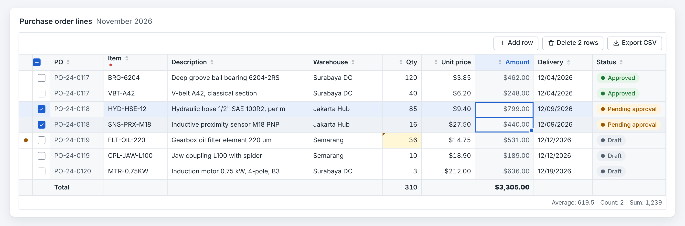

<p align="center">
  <picture>
    <source media="(prefers-color-scheme: dark)" srcset="https://raw.githubusercontent.com/JoxNeis/enterract/main/.github/assets/banner-dark.svg">
    
  </picture>
</p>
<p align="center">
  <strong>React components for ERP applications</strong><br>
  Forms, lookups, Excel-style data grids, workflow and approval controls.
</p>
<p align="center">
  <a href="https://www.npmjs.com/package/enterract"></a>
  
  
  <a href="https://www.npmjs.com/package/enterract"></a>
</p>
<p align="center">
  <a href="https://joxneis.github.io/enterract"><strong>Storybook</strong></a> ·
  <a href="docs/CONTROLS.md"><strong>Components</strong></a> ·
  <a href="docs/THEMING.md"><strong>Theming</strong></a> ·
  <a href="docs/ROADMAP.md"><strong>Roadmap</strong></a>
</p>
<p align="center">
  
</p>

## Why enterract
 
- 🧩 **100+ components**: forms, lookups, data grids, approval workflows
- ♿ **Accessible** by default
- 🪶 **Zero runtime dependencies** besides React
- 🌍 **Locale-aware** number, date and currency formatting
- 🎨 **Themeable** with `--erp-*` CSS variables: dark mode, per-tenant brands, compact density
- 📦 **ESM + TypeScript**, with per-component imports
## Install
 
```sh
npm install enterract
```
 
Peer dependencies: `react` and `react-dom` 19.
 
## Usage
 
```tsx
import { Button, TextField, LocaleProvider } from 'enterract'
// or import one component (smaller dev builds):
import { DataGrid, useGridRows } from 'enterract/components/DataGrid'
 
export function App() {
  return (
    <LocaleProvider locale='de-DE' currency='EUR'>
      <TextField label='Reference' />
      <Button variant='primary'>Save</Button>
    </LocaleProvider>
  )
}
```
 
Styles load automatically with each component, so there's no CSS file to import. `LocaleProvider` sets number, date and currency formatting for everything inside it.
 
## Theming
 
Everything is driven by `--erp-*` CSS variables. Override them in your own CSS and they always win, whatever the load order:
 
```css
:root {
  --erp-color-primary: #7a1fa2;
  --erp-font-family: 'Inter', sans-serif;
  --erp-radius: 2px;
}
```
 
You can also theme part of a page (dark mode, per-tenant brands), switch density with `data-density="compact"`, or restyle single components through `className` and their `erp-*` classes. See the [theming guide](docs/THEMING.md).
 
## Documentation
 
| | |
| --- | --- |
| [Theming and customization](docs/THEMING.md) | CSS variables, dark mode, density |
| [Control catalog](docs/CONTROLS.md) | Every control and its status |
| [Component docs](docs/components/) | Props and examples per component |
| [Form control contract](docs/FORM-CONTROL-CONTRACT.md) | How form controls behave |
| [Component conventions](docs/CONVENTIONS.md) | Naming, structure, patterns |
| [Roadmap](docs/ROADMAP.md) | What's coming next |
 
## Contributing
 
<details>
<summary>Development commands</summary>
<br>
| Command | |
| --- | --- |
| `npm run storybook` | Component explorer with docs, on :6006 |
| `npm test` | Vitest in watch mode |
| `npm run check` | Typecheck, lint, tests and audit |
| `npm run build` | Library build to `dist/` |
| `npm run build-storybook` | Static Storybook to `storybook-static/` |
| `npm pack` | Create the installable `.tgz` |
 
</details>
 
